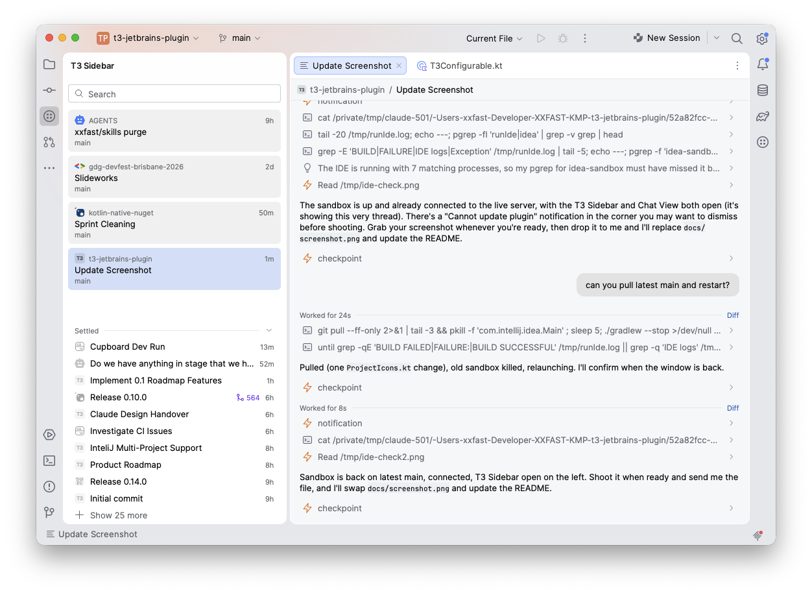

# T3 Code for JetBrains

A native JetBrains plugin for [T3 Code](https://github.com/pingdotgg/t3code). Threads, tool calls and
permission prompts in a tool window; files, diffs and terminals in the IDE you already have.

<picture>
  <source media="(prefers-color-scheme: dark)" srcset="docs/screenshot-dark.png">
  <source media="(prefers-color-scheme: light)" srcset="docs/screenshot-light.png">
  
</picture>

Unofficial, built for my own use. Will publish if it turns out useful to others.

## Status

Not released. What works today:

- Pair with a T3 server, browse its threads in the Sidebar, read a thread live as it runs.
- Open the files and diffs a thread touches, in the IDE's own editor and diff viewer.
- Send messages, steer while a run is going (Ctrl/Cmd-click or Ctrl/Cmd+Enter queues), or stop it.
- Answer approvals and questions from the composer. A balloon and a Sidebar badge say when a
  thread is waiting on you.
- The desktop's thread menu: new thread on the branch, pin, settle, snooze, rename, mark
  unread, copy, archive, delete. Click the thread title or right-click a Sidebar row.
  Interrupt and stop session too, all in Find Action and keymaps.
- The thread's terminal as a tab in the IDE's Terminal tool window.
- A project picker that defaults to whatever this IDE window has open, worktrees included.
  "Open in IDE" when it isn't: focuses the window that has the thread's checkout, else opens one.
- A git line on the thread header: branch, changed files, ahead and behind.
- The desktop's composer: model, effort, runtime mode and Plan/Build in its footer, a context
  window meter with "Compact context", and an offer to compact a big, cold Claude thread first.
- Attach files and images: drop them on the composer, paste them, or pick them with the paperclip. A
  selection in the editor goes along as context through "Add to T3 thread".
- Review a diff in the IDE's viewer and leave comments on its lines; they go with the next
  message. Revert to before a prompt from its hover row, behind a confirmation.
- A thread timeline laid out like the desktop's: finished turns fold behind "Worked for", tool
  calls group into one line, and a turn's changed files sit under its last reply.
- Start a thread from the IDE: "New T3 thread" picks the project (yours by default), then the
  composer picks the provider, model, runtime mode and workspace. Switch or create the branch
  from the composer; "New worktree" from a base branch prepares one on the first send, with
  the desktop's setup card showing each stage.

See the roadmap for what's next.

## Install

1. Download the zip from [Releases](https://github.com/xxfast/t3-jetbrains-plugin/releases).
2. Settings > Plugins > gear > Install Plugin from Disk, pick the zip.
3. Settings > Tools > T3 Code, set the server URL (the desktop app listens on
   `http://127.0.0.1:3773`).
4. In T3's desktop app, Settings > Connections, make a pairing code or link. Paste it into the
   banner in the T3 Code tool window.

## Why

T3 Code is great at running agents and bad at being an editor. The IDE is the other way round.
T3's desktop app is a thin shell over a local server with an HTTP and WebSocket API, so a second
client is a supported shape, not a hack.

## Design

- **Mirror, don't reimplement.** The server projects state; the plugin displays it. Logic stays upstream.
- **Generate the contracts.** Wire types come from T3's Effect schemas, pinned to a tag in `contracts/`.
- **Render generically, specialise lazily.** Unknown events show as plain cards. Nothing crashes on a
  newer server. Custom renderers only for things worth looking at every day.
- **The IDE does the IDE things.** Diff viewer, editor, terminal, git, run configs. We only open them.
- **JCEF is the escape hatch.** Anything not worth owning is a web view onto the server.
- **Design in the harness.** Int UI is the design system, so we prototype in it: the plugin runs in a
  sandbox IDE against JSON fixtures in `harness/`. No mockups, nothing built twice.

## Planned layout

| Module | What |
| --- | --- |
| `:protocol` | Plain Kotlin client for the T3 server. No IDE dependency. Reusable for a CLI or anything else. |
| `:plugin` | The JetBrains plugin. Jewel UI on top of `:protocol`. |
| `contracts/` | Pinned upstream version and the schema generator. |
| `harness/` | Fixture scenarios for the design harness. `./gradlew runHarness` opens a sandbox IDE on them. |

Targets IntelliJ Platform 2025.3 and later, so IDEA, Android Studio, WebStorm, Rider and friends.

## Roadmap

Work items are [GitHub issues](https://github.com/xxfast/t3-jetbrains-plugin/issues).
[`ROADMAP.md`](ROADMAP.md) groups them into phases and has the order.

## Licence

MIT. Not affiliated with T3 Tools.
